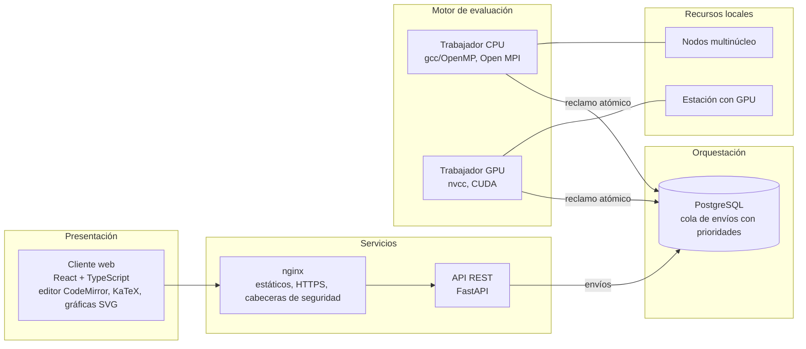
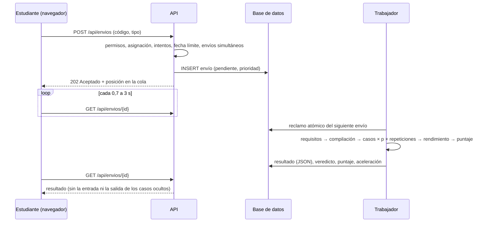

# Arquitectura de LabPar

Este documento describe cómo está construida la plataforma y cómo se corresponde con la arquitectura de referencia por capas y con el Product Backlog (épicas E1–E8) del documento del Proyecto 12.

## 1. Capas y componentes

| Capa del documento | Implementación | Ubicación |
|---|---|---|
| Presentación | Aplicación de una sola página en React 19 con TypeScript. Editor CodeMirror 6 que resalta las construcciones paralelas con el color de su modelo, enunciados en Markdown con fórmulas KaTeX y gráficas SVG propias. | `frontend/src` |
| Servicios | API REST con FastAPI: autenticación JWT, roles, cursos, laboratorios, envíos, analítica, encuesta SUS y exportaciones. Documentación interactiva en `/api/docs`. | `backend/labpar/rutas`, `main.py` |
| Orquestación | Cola de envíos en la base de datos, con prioridades (consola 10, salidas de referencia 7, evaluación 5) y reclamo atómico (`UPDATE … WHERE estado = 'pendiente'`). Cada trabajador toma los envíos de los modelos que puede ejecutar y deja los de CUDA a los nodos con GPU mientras estén en línea. Los envíos huérfanos vuelven a la cola. | `backend/labpar/worker.py` |
| Motor de evaluación | Procesos trabajadores que compilan, ejecutan en aislamiento, comparan salidas, miden el rendimiento y generan la retroalimentación. | `backend/labpar/motor` |
| Recursos locales | Uno o varios nodos con Docker. Los nodos con GPU usan la misma imagen sobre la base `nvidia/cuda`. | `docker-compose*.yml` |

La planificación con Slurm y la integración LTI 1.3, que el documento propone como opcionales, quedan como trabajo futuro. El diseño ya separa la cola de la ejecución, de modo que un trabajador puede convertirse en un adaptador que envíe el trabajo a Slurm sin cambiar la API.

## 2. Flujo de un envío

## 3. Motor de evaluación

Una evaluación completa recorre cinco fases (`motor/evaluador.py`):

1. **Requisitos y heurísticas.** Se comprueban expresiones regulares obligatorias y prohibidas sobre el código sin comentarios ni cadenas; por ejemplo, exigir `MPI_Send` o prohibir `MPI_Reduce`. También se aplica un análisis estático por modelo: posibles condiciones de carrera, `critical` dentro de bucles, número de hilos fijado en el código, impresión desde todos los procesos MPI, kernels sin verificación de límites, etc.
2. **Compilación.** Se usa `gcc -O2 -fopenmp`, `mpicc` o `nvcc -O2`. Los diagnósticos se traducen y se explican en español con su número de línea, que la interfaz marca en el editor.
3. **Corrección.** Cada caso se ejecuta con varios valores de *p* y varias repeticiones. Del patrón de fallos se deduce el diagnóstico:

   | Patrón observado | Diagnóstico |
   |---|---|
   | Correcto con *p* = 1, incorrecto con *p* > 1 | Condición de carrera (OpenMP) o reparto incorrecto (MPI) |
   | Salidas distintas entre repeticiones con el mismo *p* | No determinismo |
   | Termina con *p* = 1 y excede el tiempo con *p* > 1 | Interbloqueo (MPI) o espera infinita |
   | Incorrecto también con *p* = 1 | Error de lógica o de formato, con la línea de la primera diferencia |

   Si un valor de *p* excede el tiempo, los casos siguientes no se ejecutan con ese *p* (falla rápida), y hay un presupuesto total de tiempo por evaluación.
4. **Rendimiento.** Solo se mide si todos los casos son correctos. Con el nodo en uso exclusivo (candado de lectores y escritores entre trabajadores del mismo nodo), se mide la versión secuencial de referencia y el programa con cada *p* ≤ núcleos, y se toma el mínimo de varias repeticiones. El tiempo se lee de la línea `LABPAR_TIEMPO=<s>` que imprime el programa en la salida de errores, o del tiempo total del proceso si falta.
5. **Puntaje y retroalimentación.**

Métricas, con *T*ref el tiempo de la referencia secuencial y *T*p el del programa con *p* hilos o procesos:

- aceleración *S*p = *T*ref / *T*p; eficiencia *E*p = *S*p / *p*;
- fracción serial de Karp–Flatt *e* = (1/*S'*p − 1/*p*) / (1 − 1/*p*), con *S'*p = *T*1 / *T*p (aceleración relativa);
- objetivo *S*obj = máx(1, *E*obj · *p*máx). En CUDA el objetivo es una aceleración absoluta frente a la CPU.

Puntaje sobre 100, con pesos configurables por laboratorio (70/30 por defecto):

- corrección: peso de la corrección × (peso de los casos aprobados / peso total);
- rendimiento: peso del rendimiento × mín(1, máx(0, (*S* − 1) / (*S*obj − 1))), solo si la corrección es completa;
- si el código no cumple los requisitos, el puntaje máximo es 50; si el nodo no permite medir (un núcleo), la corrección vale el 100 %.

### Aislamiento (`motor/sandbox.py`)

| Capa | Mecanismo |
|---|---|
| Usuario | Cada programa se ejecuta como `alumno` (uid 2000), nunca como el usuario del servicio. El directorio de cada envío es temporal y se borra al terminar. |
| Recursos | `setrlimit`: tiempo de CPU, espacio de direcciones (OpenMP y secuencial), tamaño de archivos, número de procesos y sin volcados de memoria. Además, tiempo de reloj con terminación de todo el grupo de procesos, y salida estándar truncada. |
| Entorno | Variables mínimas: no se heredan credenciales ni la cadena de conexión de la base de datos. |
| Red | En Docker, `iptables` rechaza toda conexión del usuario `alumno` excepto por la interfaz local, que Open MPI usa para coordinar sus procesos (`docker/entrada-trabajador.sh`). |
| Contenedor | Red interna sin Internet, `no-new-privileges`, límites de memoria y de PID del contenedor, que acotan MPI y CUDA. |

El trabajador comprueba al iniciar que el usuario aislado puede ejecutar programas en su directorio de trabajo; si no, se detiene con un mensaje que indica el problema de permisos.

## 4. Modelo de datos

| Tabla | Contenido |
|---|---|
| `usuarios` | Nombre, correo, huella bcrypt de la contraseña, rol, consentimiento para investigación y su fecha |
| `cursos`, `inscripciones` | Curso, docente, código de inscripción, encuesta activa; estudiantes inscritos |
| `laboratorios`, `casos_prueba` | Enunciado, plantilla, referencia secuencial, solución docente, configuración de evaluación (JSON), objetivos, pistas, preguntas; casos visibles u ocultos con peso |
| `asignaciones` | Laboratorio en un curso, con fecha límite e intentos máximos |
| `envios` | Código, tipo (evaluación, consola o referencia), estado en la cola, resultado completo (JSON), veredicto, puntaje y aceleración |
| `borradores` | Último código de cada estudiante en cada laboratorio (autoguardado, para retomarlo desde otro equipo) |
| `eventos` | Registros de uso para la analítica: laboratorio abierto, pista vista, pregunta respondida, simulador usado, ingreso |
| `respuestas_sus` | Las diez respuestas y el puntaje SUS por estudiante y curso |
| `trabajadores` | Latido, estado y capacidades (núcleos, OpenMP, MPI, CUDA) de cada proceso del motor |

## 5. Privacidad (Ley 1581 de 2012)

- El código de un estudiante lo ven él, el docente de los cursos donde lo envió y el administrador. Otros docentes reciben 403; las pruebas automatizadas lo verifican.
- A los estudiantes nunca se les envían la entrada ni la salida de los casos ocultos.
- Las exportaciones CSV incluyen solo a quienes autorizaron el uso de sus datos para investigación. Cada estudiante aparece con un seudónimo HMAC estable (`E-XXXXXXXXXX`). El docente ve cuántos dieron su autorización, pero no quiénes, para evitar presiones.
- El consentimiento es opcional, se puede revocar desde el perfil y su cambio queda registrado.

## 6. API

La especificación completa, con esquemas y pruebas interactivas, está en `/api/docs` (OpenAPI). Resumen:

| Recurso | Rutas |
|---|---|
| Autenticación y perfil | `POST /auth/registro`, `POST /auth/ingresar`, `GET/PATCH /auth/yo`, `GET /auth/config-publica` |
| Cursos | `GET/POST /cursos`, `GET/PATCH /cursos/{id}`, `POST /cursos/inscribirse`, `POST /cursos/{id}/regenerar-codigo`, `GET /cursos/{id}/estudiantes`, `DELETE /cursos/{id}/estudiantes/{u}` |
| Asignaciones | `GET/POST /cursos/{id}/asignaciones`, `PATCH/DELETE /asignaciones/{id}` |
| Laboratorios | `GET/POST /laboratorios`, `GET/PUT/DELETE /laboratorios/{id}`, `POST …/duplicar`, `GET …/exportar`, `POST /laboratorios/importar`, `POST …/casos`, `PUT/DELETE /casos/{id}`, `POST …/generar-salidas`, `GET/PUT/DELETE …/borrador` |
| Envíos | `POST /envios`, `GET /envios`, `GET /envios/{id}`, `GET /envios/{id}/codigo` |
| Analítica e investigación | `GET /cursos/{id}/progreso`, `GET /cursos/{id}/analitica`, `GET /cursos/{id}/exportar/{envios,progreso,eventos,sus}.csv`, `POST /eventos` |
| Encuesta SUS | `GET/POST /sus/{curso}` |
| Administración | `GET /admin/estado`, `GET/POST /admin/usuarios`, `PATCH /admin/usuarios/{id}`, `POST /admin/envios/{id}/reintentar`, `GET /salud` |

## 7. Correspondencia con el Product Backlog

| Épica | Estado en esta versión |
|---|---|
| E1. Usuarios y cursos | Registro con código de curso y consentimiento; roles estudiante, docente y administrador; cursos, inscripción, asignaciones con fecha límite e intentos. LTI 1.3: pendiente. |
| E2. Laboratorio OpenMP | Editor web con plantillas, consola con 1, 2, 4 u 8 hilos, cuatro laboratorios del banco. |
| E3. Laboratorio MPI | Ejecución con 1 a 4 procesos (configurable) en un nodo; tres laboratorios, incluido el diagnóstico de interbloqueos. Varios nodos con Slurm: pendiente. |
| E4. Laboratorio CUDA | Compilación con nvcc y ejecución en GPU mediante el trabajador GPU; dos laboratorios. El estudiante varía la malla y el tamaño de bloque en el código. |
| E5. Motor de evaluación paralelizado | Cola con prioridades, trabajadores concurrentes en uno o varios nodos, ejecución aislada en contenedores, repeticiones, métricas de desempeño y reparto según las capacidades de cada nodo. |
| E6. Retroalimentación y analítica | Resultado por caso y por *p*, diagnóstico del fallo, errores del compilador explicados, sugerencias, matriz de progreso, tablero con las dificultades más frecuentes, tiempos hasta aceptar y aceleraciones. |
| E7. Banco de ejercicios | Nueve laboratorios con objetivos de Bloom, enunciados, casos, pistas y preguntas; editor web, duplicación, importación y exportación entre semestres. |
| E8. Seguridad y operación | Límites de recursos, cuotas de envíos e intentos, limitador de ingresos fallidos, registro de eventos, estado de los nodos, copias de seguridad (`scripts/`) e integración continua (`.github/workflows`). |

## 8. Decisiones técnicas

- **Cola en la base de datos en lugar de un intermediario de mensajes.** Para el volumen de un curso (decenas de estudiantes y de envíos por minuto), PostgreSQL basta: se evitan un servicio y un punto de fallo adicionales, y el estado de cada envío queda en un solo lugar. Si la carga creciera, la función `reclamar` puede sustituirse por Redis o RabbitMQ sin cambiar la API.
- **Medición exclusiva por nodo.** La aceleración solo tiene sentido si el programa no compite por los núcleos. Las ejecuciones de corrección comparten el nodo, pero las de rendimiento toman un candado exclusivo.
- **Seudónimos con HMAC.** Un hash sin clave del identificador sería reversible por fuerza bruta, porque los identificadores son pocos. Con la clave del servidor no lo es, y el seudónimo se mantiene estable entre exportaciones.
- **SQLite en desarrollo, PostgreSQL en producción.** La misma suite de pruebas corre contra ambos motores.
